# Goal

Made by Vibe Coders for Vibe Coders to prepare the way of the Lord and make His paths straight. 

**Isaiah 40:3 “...Prepare the way for the LORD in the wilderness; make a straight highway for our God in the desert."**

## Bottom line up front

- **Why:** we believe the answer to the Great Commission is multiplying indigenous disciples,
  churches and leaders among every remaining people group. That can't be done without maps, so
  dx-maps gives the church map solutions to help finish world evangelization.
- **How it was made:** no human wrote this code. It is about 100% AI-coded, and about 90% of the
  maps began as a vision spoken aloud (voice-to-text, such as Rudder) and handed to an AI agent that
  built it with dx-maps. If you can picture a map and say it in plain English, an agent can build it.
- **Our favorite:** the experimental Gospel × Internet dashboard: the most experimental, and likely
  the most impactful for the Great Commission, because everything comes together there.
  It is inspired by the Perspectives course and book, and by Curtis Sergeant's 100-list and
  relational-stewardship training (bounded and centered sets).
- **What each map is for:**
  - **Big Picture:** the library's own interface, the one agents use to build maps.
  - **UPG-100:** the most strategic. It divides the task into prayer packets.
  - **Gospel maps:** the resources that exist in each language.
  - **UPG Neighbor:** the reached neighbors near each unreached group.
  - **Gospel × Internet:** all of it, together. Built for linguists, catalysts, translators (human
    and AI) and prayer warriors.

Built with love, with the prayer that these maps bless the nations.

# dx-maps — one build, maps that embed everywhere

**Write a map once in `plugin-designs/<your-map>/`, run one build, and drop it on any site** —
iframe, script embed, mobile app — or open every map at once as one app. Five plugin
capabilities, three outputs, one shared library, one build.

> **Using an AI agent?** Give it [`skills/plugin-designer`](./skills/plugin-designer). It learns
> this framework's terms and patterns, which lowers the barrier to entry.

### What the library gives every map

| | |
|---|---|
| 🗺️ **Two map engines** | Every map draws with **Mapbox** or **MapLibre** (free, no key) — switch with `"provider"` in its settings or `?provider=maplibre` in the address. By default it uses Mapbox when a token is available, MapLibre otherwise. |
| 🔑 **A key or a key service** | Give Mapbox a public token, or the address of a token service that hands one out — set once in the Plugin Studio header. |
| 🌍 **11 languages** | `?lang=` or `"locale"`, with Arabic right to left — [Languages](#languages). |
| 🧩 **Web components** | Each map is its own HTML tag, like `<all-people-groups>`, that works on any page — no framework needed. |
| 🔗 **Maps that talk to each other** | Maps share props and events, so one app can nest them and a click in one can move another. |
| 🪶 **Small bundles** | Each map's file carries only the parts of the shared library it uses (tree-shaken). |
| ⚙️ **One build step** | `bun run build` makes every map at once. |
| 📦 **Three outputs** | A web folder (iframe, script embed), a mobile app, a desktop app — [the 3 outputs](#what-the-build-makes--3-outputs). |

| What dx-maps set out to do | Proof |
|---|---|
| **One build → one folder** you can drop on any host | `bun run check:drop` |
| **Every map embeddable** from a copy-paste snippet | [the 3 outputs](#what-the-build-makes--3-outputs) · `bun run check:embed-targets` |
| **Every map interoperable** through props and events | `bun run verify:interop` |
| **One app nests every map** — and each stays embeddable on its own | [capability 5](#capability-5--app-shell-the-research-gallery) · `bun run check:composite-reg` |
| **5 capabilities, every one shippable in every output** | `bun run verify:5-caps` |
| **Shared library, private plugins** — reuse without breaking each other | `bun run check:library-index` |
| **One agent per plugin, one shepherd, one working `main`** | [agent swarm](#build-it-with-an-agent-swarm) |

*Click any ▸ to read more. Everything below is folded so you can scroll the pictures first.*

---

## The 7 production maps

**Seven maps DX uses today** — each one a plugin you can embed on its own, and all seven together in
the Research Gallery.

<table>
<tr>
<td width="25%" valign="top">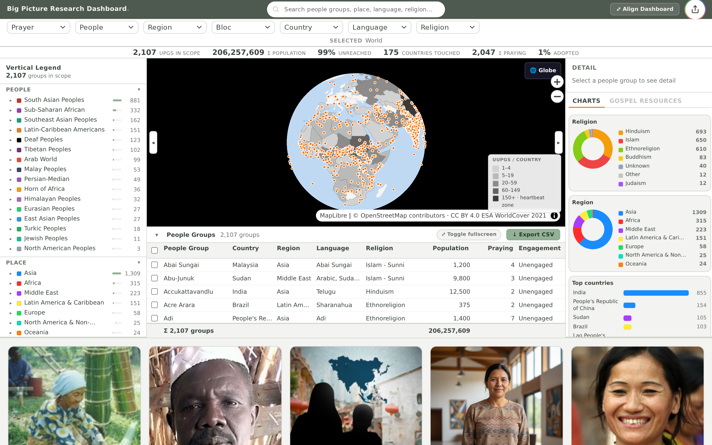<br><b>Big Picture</b><br><sub>the whole research dashboard: filters, map, charts, people groups</sub></td>
<td width="25%" valign="top">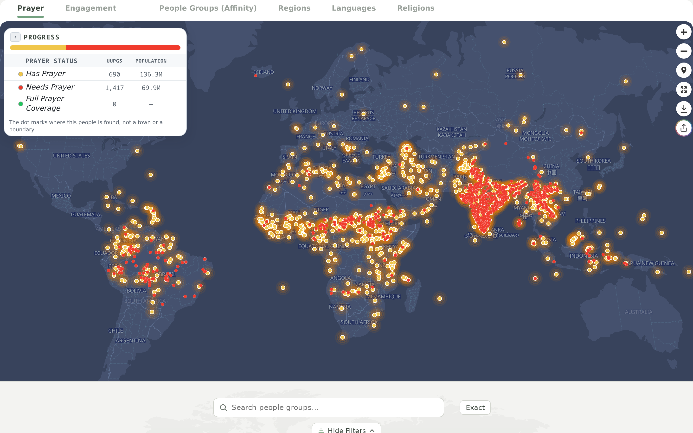<br><b>Simple Research</b><br><sub>the research map with the people-groups grid, made for phones</sub></td>
<td width="25%" valign="top"><br><b>Regions</b><br><sub>every region and its countries, then a dashboard per region</sub></td>
<td width="25%" valign="top"><br><b>UPG-100 List</b><br><sub>prayer lists of 100 people groups, with posters to print</sub></td>
</tr>
<tr>
<td width="25%" valign="top">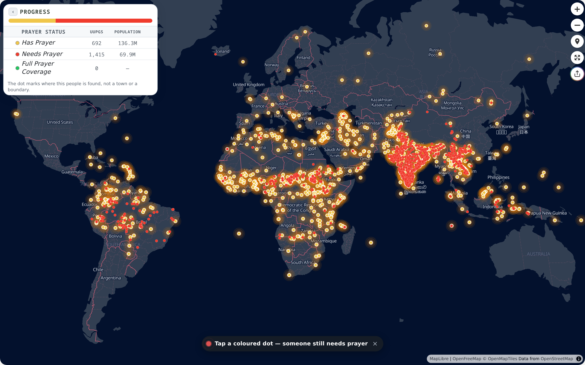<br><b>Prayer Progress</b><br><sub>where prayer is happening, and where it is still needed</sub></td>
<td width="25%" valign="top">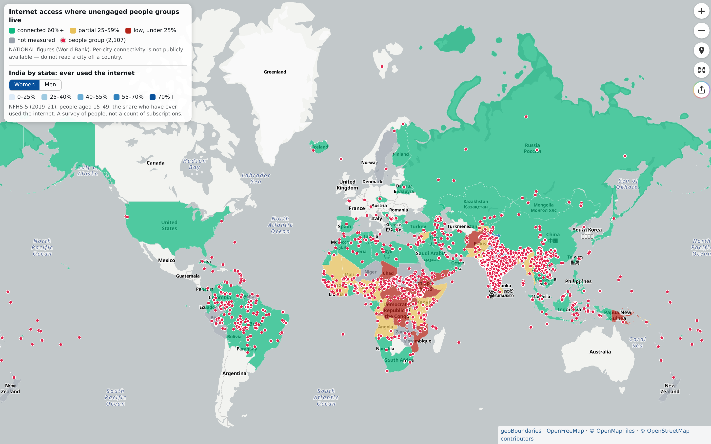<br><b>Cities with Internet</b><br><sub>internet access where unreached people groups live</sub></td>
<td width="25%" valign="top"><br><b>Gospel Resources</b><br><sub>which people groups have scripture, film or audio — and which have nothing</sub></td>
<td width="25%" valign="top">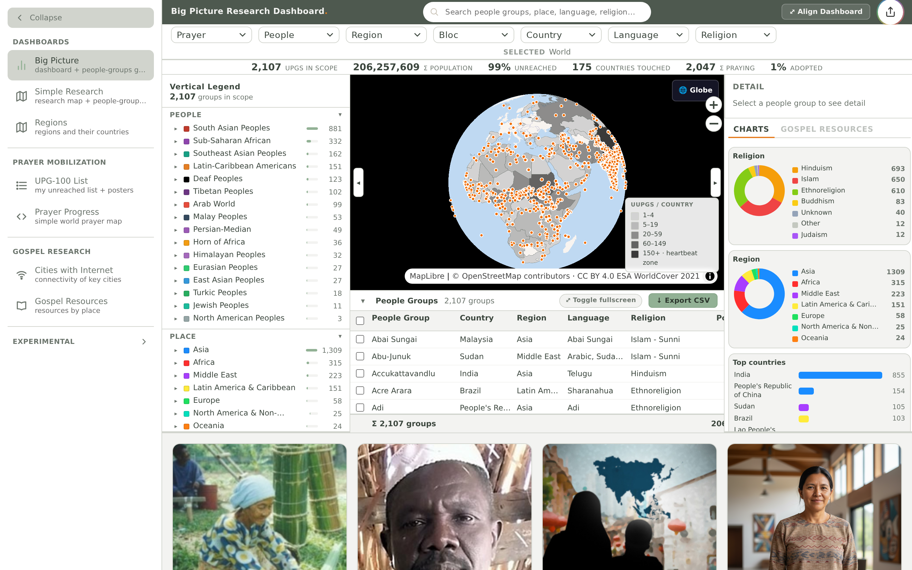<br><b>Research Gallery</b><br><sub>all seven in one app — capability 5</sub></td>
</tr>
</table>

### On a phone

<table>
<tr>
<td width="25%" valign="top"><br><b>Simple Research</b></td>
<td width="25%" valign="top">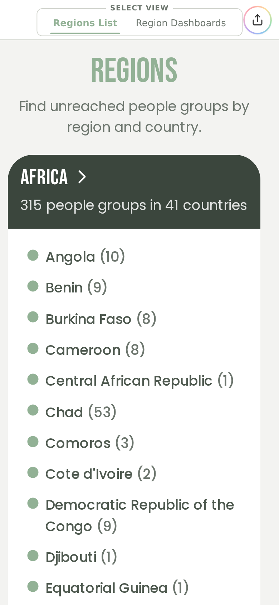<br><b>Regions</b></td>
<td width="25%" valign="top">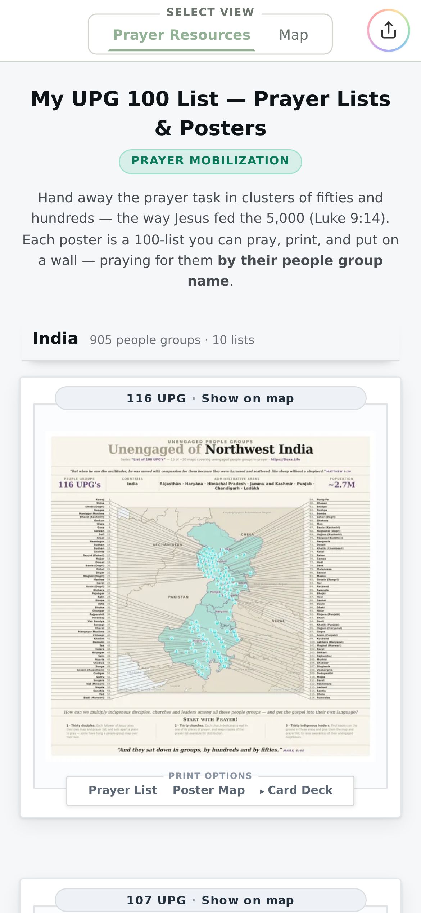<br><b>UPG-100 List</b></td>
<td width="25%" valign="top"><br><b>Prayer Progress</b></td>
</tr>
<tr>
<td width="25%" valign="top">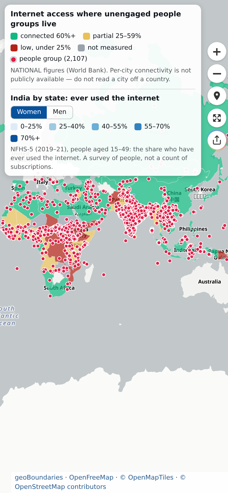<br><b>Cities with Internet</b></td>
<td width="25%" valign="top">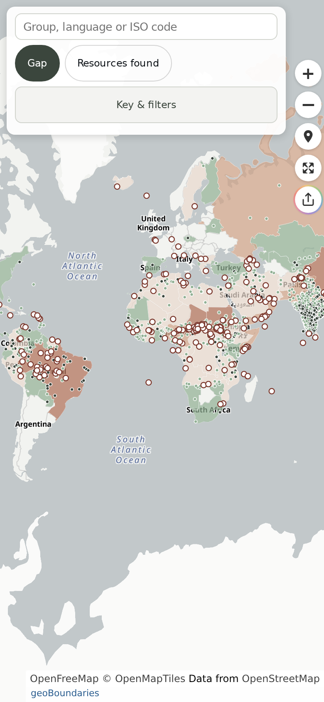<br><b>Gospel Resources</b></td>
<td width="25%" valign="top"><br><b>Research Gallery</b></td>
<td width="25%" valign="top"><b>Big Picture</b><br><sub>a desktop dashboard by design — on a phone, Simple Research is the dashboard, and the Research Gallery opens on it.</sub></td>
</tr>
</table>

### Every capability ships every way

| Capability | Example | iframe | Mobile app | JavaScript embed | WordPress / Disciple Tools | Desktop |
|---|---|:-:|:-:|:-:|:-:|:-:|
| **5 — app shell** | Research Gallery | ✅ | ✅ | ✅ | 🧪 | 🧪 |
| **4 — composite** | UPG-100 List | ✅ | ✅ | ✅ | 🧪 | 🧪 |
| **3 — multi-view** | research map | ✅ | ✅ | ✅ | 🧪 | 🧪 |
| **2 — presets** | Prayer Progress | ✅ | ✅ | ✅ | 🧪 | 🧪 |
| **1 — single element** | all people groups | ✅ | ✅ | ✅ | 🧪 | 🧪 |

<sub>✅ works today · 🧪 proven, not yet in production. Every plugin builds into the same folder, and that folder is what all five methods ship — so a capability never limits where a plugin can go.</sub>

### The Experimental shelf

**New plugins the Research Gallery picks up by itself** — each builds and embeds like any other,
and graduates to a named tab when it's ready.

<table>
<tr>
<td width="50%" valign="top"><br><b>Wall of People Groups</b><br><sub>all 2,107 Doxa people groups as photo cards on one zoomable prayer wall, with a pray dialog</sub></td>
<td width="50%" valign="top">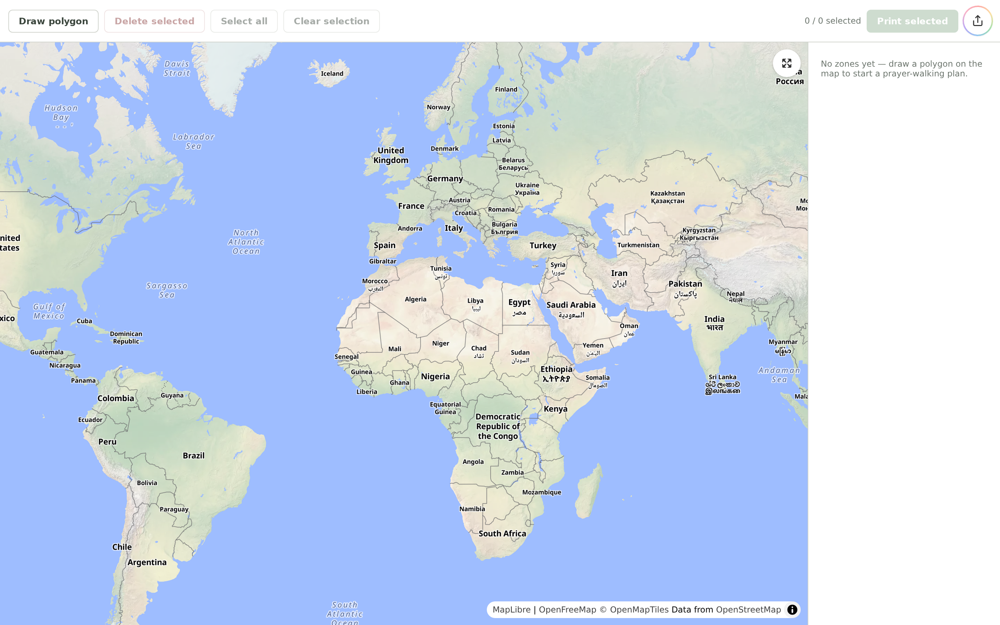<br><b>Prayer Walk Planner</b><br><sub>plan a prayer walk through a zone, open it full screen from any embed, and print a walking map that stays sharp when zoomed</sub></td>
</tr>
</table>

<sub>Also on the shelf: UPG neighbor, all people groups, country posters, the vision card, and the PPLR data maps.</sub>

<details>
<summary><b>How one build becomes three outputs — the "map cruncher"</b></summary>

```text
 map · map · map · map · map · map · map        many maps, each once its own codebase
   \    \    |    |    |    /    /
    +----- plugin-designs/ ------+              one folder per plugin — the free zone
                 |
           library/ (@map)                      shared, reusable pieces — the high bar
                 |
            ONE build step
                 |
          public/dx-maps/                     OUTPUT 1: one drop-anywhere web folder
          /       |        \                   how a page shows a map:
      iframe   JS embed   WordPress            (WordPress just for fun)

    the same folder, wrapped:
    mobile app (OUTPUT 2) · desktop app (OUTPUT 3)
```

</details>

---

## Who it's for

### Vibe coders — who dx-maps was built for

If you build with AI agents, this repo is made for you:

- **One repo, many plugins.** Each plugin is one folder in `plugin-designs/` with its own `src/`,
  and they all share one library, so your agents can build many plugins side by side.
- **See every design live.** `bun run dev` opens the Plugin Studio: every plugin in one place,
  updating the moment you save.
- **Speak instead of typing.** Rudder, an offline voice-to-text tool, sits as a corner widget in the
  Studio: look at a plugin, say what you see, and hand the text to your agent. Nothing leaves your
  computer (Linux today).
- **One plugin, several outputs.** The same plugin ships as a web embed or a mobile app, and a plugin
  can target the desktop: Rudder is the desktop example, a corner widget in the Studio and its own
  desktop app (`bun run desktop:build rudder-voice`, see [HOWTO-build-the-desktop-app](./documentation/HOWTO-build-the-desktop-app.md)).
- **Build together.** [Run it in the cloud](#run-it-in-the-cloud) gives a whole team one shared dev
  server.

### The people doing the work

**Each map answers a real task for someone doing the mission.** Open it in the Research Gallery, or
embed just the one you need.

| You are… | Open | It answers |
|---|---|---|
| a **translator** (or an AI translation pipeline) | Gospel Resources (map, list, data tables) | which people groups have no Scripture, film or audio in their language, and which bridge language already reaches them |
| **media to movements** | Cities with Internet · Gospel × Internet | where unreached people groups live with internet access, country by country and down to province where data exists |
| a **catalyst** or mobilizer | Big Picture · Prayer Walk Planner · UPG 100 List · Gospel × Internet | find **gospel resources** for the people you are reaching real time, build prayer walking maps for real outreach, as you prayer walk each key zone in your cities of choice, find indigenous disciples, groups, and leaders mobilize them each to have prayer packets, cards and posters to blanket all the people groups in prayer as a prayer mobilizer catalyst  |
| **praying** | Prayer Progress · UPG-100 List | where prayer is covered and where it is still needed; print a **Prayer List**, **Poster Map** or **Card Deck** for a list of 100 |
| a **teacher** or presenter | the Research Gallery | every map in one app, multiple languages support |

<details>
<summary><b>For AI agents</b></summary>

- **Every map, and how to embed it:** `public/dx-maps/manifest.json` lists each plugin with its
  `embed.iframe` and `embed.script` snippet (with its integrity hash).
- **The data behind the maps:** `public/dx-maps/assets/tables/*.json` (gospel access, internet
  access, bridge languages, resource links…), `assets/people-groups/*.json` (points and slim
  records) and `assets/people-groups/lists/` (the membership of each list).
- **Live people-group data (public, no key):** `https://pray.doxa.life/api/people-groups/list`
  and `…/detail/{slug}`, the same endpoints the published maps call.
- **Switches on any map page:** `?lang=` (11 languages), `?provider=maplibre|mapbox`,
  `?list=` (a project list such as `700`), `?tk=` (a Mapbox token). Embeds take the same keys in
  `profile-config`. Contract: [documentation/reference-universal-props.md](./documentation/reference-universal-props.md).

</details>

---

## The 5 plugin capabilities

A capability is **how much a plugin nests**, from one element (1) to an app of apps (5). Every
screenshot is a real plugin from this repo's build.

### Capability 5 — app shell: the Research Gallery

**One plugin that holds every map as a tab** — and each tab is still a plugin you can embed on its own.


<details>
<summary><b>More about capability 5 — the app shell</b></summary>

An app shell is the outer frame of a whole app: a rail of tabs down the side, a header, and
navigation. Each tab loads a **real plugin** from a lower capability, only when you open it, so the
app stays fast. Nothing is copied into the shell: when a plugin improves, the shell shows the
improvement on the next build.

- **Where it lives:** `plugin-designs/doxa-maps-spa/` — one element, `<doxa-maps-spa>`.
- **Changing the tabs:** the order and grouping are one list, `NAV_MODEL` in `doxa-maps-spa.vue`.
- **New plugins show up by themselves:** any plugin that isn't placed in a section lands on the
  folded **Experimental** shelf, read from the built `manifest.json` — no code to edit.
- **A second app shell ships too:** the Plugin Studio (below),
  which holds *every* plugin for developers.

</details>

<details>
<summary><b>What the Research Gallery is made of — seven production maps, an Experimental shelf, all five capabilities in one plugin</b></summary>

```text
Research Gallery                          <doxa-maps-spa>          capability 5
├─ Dashboards
│  ├─ Big Picture                         dashboard-plus-grid      capability 4
│  │   ├─ research dashboard              research-dashboard       capability 3
│  │   └─ people-groups grid              people-groups-grid       capability 2
│  ├─ Simple Research                     research-map-plus-grid   capability 4
│  │   ├─ research map                    doxa-research-map        capability 3
│  │   └─ people-groups grid              people-groups-grid       capability 2
│  └─ Regions                             regions-mfe              capability 4
│      ├─ regions list                    regions-list             capability 1
│      └─ region dashboards               region-dashboards        capability 1
├─ Prayer Mobilization
│  ├─ UPG-100 List                        upg-100-mfe              capability 4
│  │   ├─ list                            upg-100-list             capability 1
│  │   └─ poster wall                     poster-wall              capability 1
│  └─ Prayer Progress                     doxa-simple-map          capability 2
├─ Gospel Research
│  ├─ Cities with Internet                connectivity-map         capability 1
│  └─ Gospel Resources                    resources-map            capability 1
└─ Experimental (a folded shelf, filled automatically from manifest.json)
   ├─ prayer walk planner                 prayer-walk-planner      capability 1
   ├─ UPG neighbor                        upg-neighbor             capability 3
   ├─ all people groups                   all-people-groups        capability 1
   ├─ country posters                     country-posters          capability 4
   ├─ vision card                         doxa-vision-card         capability 2
   ├─ PPLR data maps                      pplr-data-maps           capability 3
   └─ Wall of People Groups               wall-of-people-groups    capability 3
```

</details>

### Capability 4 — composite: plugins wired together

**Several plugins glued into one**, talking to each other — and each piece still embeddable alone.


| List (capability 1, embeddable alone) | Poster wall (capability 1, embeddable alone) |
|---|---|
| 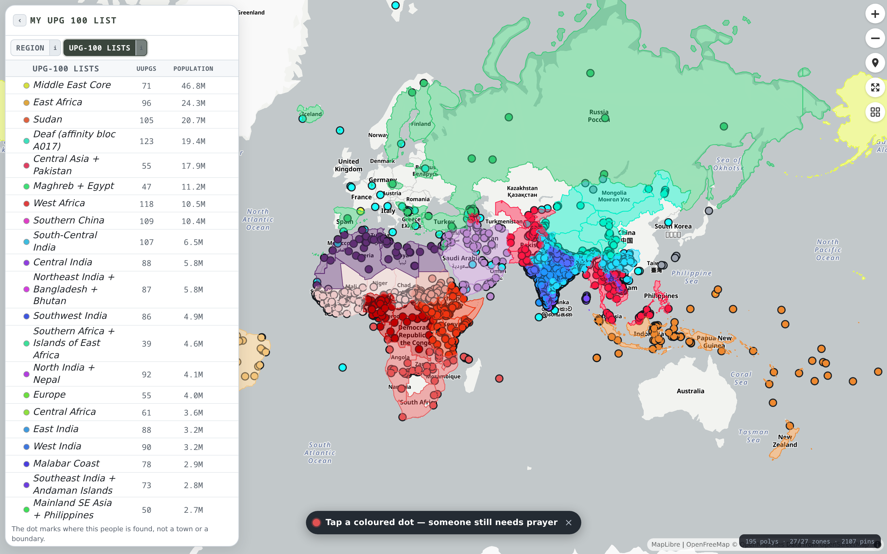 |  |

<details>
<summary><b>More about capability 4 — composites</b></summary>

A composite takes plugins that already exist and places them together — side by side, stacked, or
as views you switch between — and ships the set as **one new element**. The pieces talk through
**props** (settings passed in) and **events** (messages sent out): click a region in one piece and
another piece updates. Nothing is copied, so each piece can still be embedded on its own.

- **Example:** `plugin-designs/my-upg-100-list/` — the UPG-100 list and its poster wall, joined into
  `upg-100-mfe`. Big Picture, Simple Research and Regions are composites too.
- **How to declare one:** a `<name>.meta.json` beside it with `"type": "nested-elements-mfe"` and a
  `"composes"` list of the plugins inside.
- **The layouts that do the placing:** `VerticalTabsLayout` and `StackLayout` in `library/layouts/`.

</details>

### Capability 3 — multi-view: many screens, one element

**One plugin with several screens inside** — tabs you switch between.

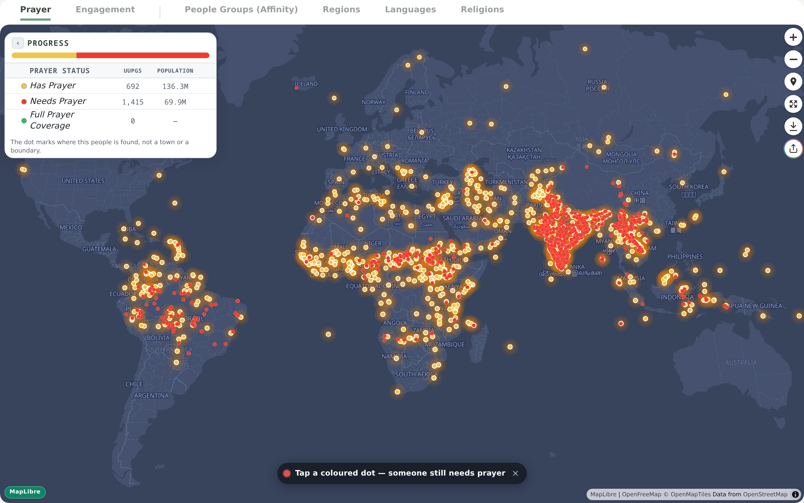

<details>
<summary><b>More about capability 3 — multi-view</b></summary>

All the screens live in one plugin, so they share code and data and switch instantly. The trade-off:
you embed the whole thing — you can't embed just one of its tabs. When you need that, split the tabs
into separate plugins and join them with a composite (capability 4).

- **Example:** `plugin-designs/doxa-research-map/` — Prayer, Engagement, People Groups, Regions,
  Languages and Religions in one map.
- **How to declare one:** a `<name>.meta.json` with `"type": "monolithic"`.

</details>

### Capability 2 — presets: one plugin, many maps

**The same map code, several ready-made versions** — each with its own page and embed code.

| Prayer | Engagement | Adoption |
|--------|------------|----------|
|  | 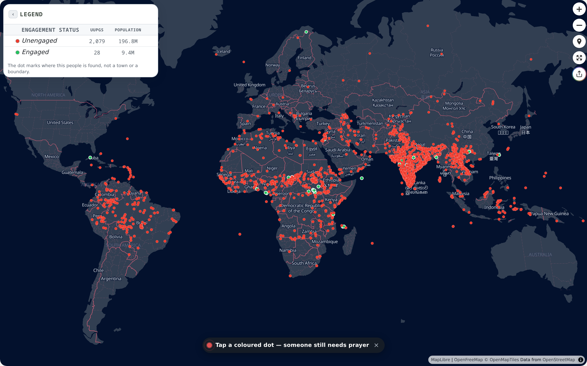 |  |

<details>
<summary><b>More about capability 2 — presets</b></summary>

You write one map, then list its versions in a small table: a name and the settings for each. The
build turns every row into its own standalone page and embed snippet — same code, different map.
Adding a version means adding a row, not writing code.

- **Example:** `plugin-designs/doxa-simple-map/` — Prayer, Engagement and Adoption from one map.
- **How to make one:** add `<name>.instances.json` beside the plugin:
  `{ "instances": [{ "id": "prayer", "title": "Prayer", "props": { … } }] }`.

</details>

### Capability 1 — single element

**One folder, one map, one tag** you can paste into any page.


<details>
<summary><b>More about capability 1 — single element</b></summary>

The simplest plugin, and where every map starts: a folder with three files — the map's `.vue`, an
`index.js` that registers its tag, and an `index.html` for previewing it. The build turns it into
one custom HTML tag, like `<all-people-groups>`, that works on any web page.

- **Example:** `plugin-designs/all-people-groups/` — every people group on one map.
- **How to make one:** copy `plugin-designs/template-bundle/` to `plugin-designs/<your-map>/` and
  rename it. The studio finds it automatically.
- **Which plugin is the example of each capability** is generated, not remembered:
  [documentation/reference-capability-exemplars.md](./documentation/reference-capability-exemplars.md).

</details>

---

## What the build makes — 3 outputs

**One build step makes one folder. That folder is the product** — every other choice is *where you
put it* and *how a page shows it*.

| # | Output | What it is | Status |
|---|---|---|---|
| **1** | **The web folder** `public/dx-maps/` | every map, each embeddable on its own, all working together — 536 files, 76 MiB (about 80 MB) | ✅ production |
| **2** | **Mobile app** | the same folder, wrapped as an Android app by Capacitor | ✅ built |
| **3** | **Desktop app** | the same folder, wrapped as a desktop app by Tauri | 🧪 proven, not yet in production |

### Output 1 — the web folder

Two questions: **where does the folder go** (hosting), and **how does a page show a map** (embedding).

#### Where the folder goes

| Put the folder… | How | iframe | JS embed | Good to know |
|---|---|:-:|:-:|---|
| **in dx-life's `public/` folder** | copy one folder; dx-life becomes the host | ✅ | ✅ | this is how the Research Gallery runs on the dx-life research page (below) |
| **on Cloudflare Pages** | drag and drop the folder in the dashboard | ✅ | ✅ | fits the drag-and-drop limits (1,000 files, 25 MiB per file); add the `_headers` file below for JS embeds on other sites |
| **on GitHub, served by jsDelivr** | push the repo to a public GitHub repo | — | ✅ | a free CDN for scripts; it serves HTML as plain text, so iframes won't render — use it for JS embeds only |
| **on any web server** | copy the folder | ✅ | ✅ | send `Access-Control-Allow-Origin: *` for JS embeds on other sites |

**Live example:** the dx-life branch [`research-gallery`](https://git.nuxtbase.app/doxa-life/doxa-maps-cdn/src/branch/research-gallery) drops this folder into dx-life's `public/` and fills `/research` with the Research Gallery. Run it with `bun install && bun run dev`, then open `/research/`.

<details>
<summary><b>More about hosting the folder</b></summary>

- **The folder works from any address.** Every link inside it is relative, so you can put it at
  `https://your-site/dx-maps/` or at a CDN root and nothing breaks (`bun run check:drop` proves it).
- **iframes need nothing special.** A map's page loads inside the frame from wherever the folder is.
- **JS embeds on another site need one header.** The embed loads scripts and `manifest.json` across
  sites with a security hash, so the host must allow it. On Cloudflare Pages (or Netlify), put a file
  named `_headers` in the folder you upload:

  ```text
  /*
    Access-Control-Allow-Origin: *
  ```

- **jsDelivr** serves any public GitHub repo as a CDN, e.g.
  `https://cdn.jsdelivr.net/gh/<owner>/<repo>@<tag>/public/dx-maps/<plugin>/<plugin>.js`. It needs a
  **GitHub** repo (this project's public copy is on its own git host), files under 20 MB (the largest
  here is 7.5 MB), and it returns HTML as plain text — hence scripts only.
- **Netlify Drop** (drag and drop at app.netlify.com/drop) works best under 50 MB; at about 80 MB, use the
  Netlify CLI instead.

</details>

#### How a page shows a map

##### iframe — the prayer map on any site ✅ production

**Paste one line of HTML and the map appears** — on any website, no coding.

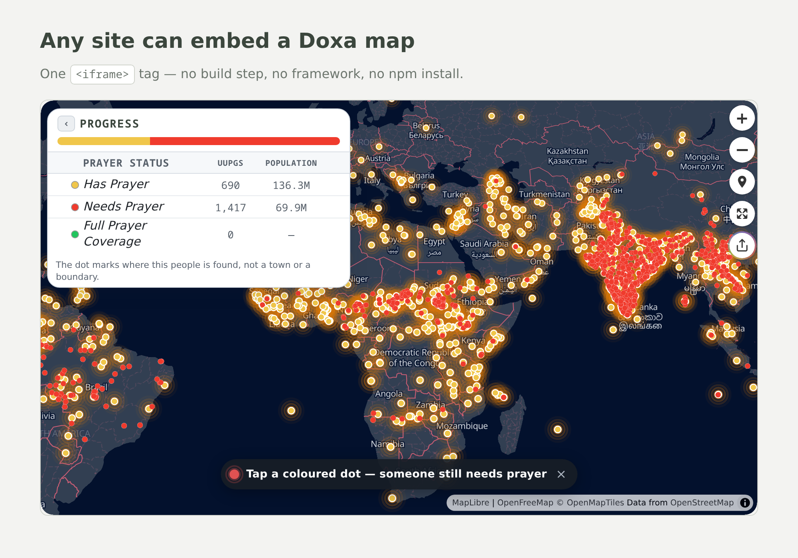

<details>
<summary><b>More about the iframe</b></summary>

An iframe is a window in your page that shows another page — here, the map's own page. It's the
easiest way to share a map: it works on any site that accepts HTML, and the map keeps its own look.
Every plugin's exact snippet is `embed.iframe` in `public/dx-maps/manifest.json`:

```html
<iframe src="https://YOUR_HOST/dx-maps/doxa-simple-map/doxa-simple-map/prayer/index.html?utm_source=YOUR_SOURCE"
        width="100%" height="600" style="border:none;border-radius:12px;" allowfullscreen></iframe>
```

</details>

##### JavaScript embed — the Research Gallery on dx-life ✅ production

**Two lines of code put a whole app inside your own page** — here, the Research Gallery on the
dx-life research page.


<details>
<summary><b>More about the JavaScript embed</b></summary>

Instead of a window onto another page, the map becomes **part of your page**, so your page can talk
to it. On dx-life, one embed of the Research Gallery replaces the separate research map, list and
regions dashboards. The exact snippet is `embed.script` in `manifest.json`; copy its `integrity`
hash from there, because it changes with every build:

```html
<script>window.MAP_APP_API_URL="https://pray.doxa.life";</script>
<script src="https://YOUR_HOST/dx-maps/doxa-maps-spa/doxa-maps-spa.js"
        integrity="sha384-…" crossorigin="anonymous"></script>
<doxa-maps-spa profile-config='{"profile":"doxa-maps-spa","tk":"YOUR_MAPBOX_TOKEN","utmSource":"YOUR_SOURCE","assetsBase":"https://YOUR_HOST/dx-maps/assets"}'></doxa-maps-spa>
```

</details>

##### WordPress / Disciple Tools — 🧪 proven, just for fun

**We got a JAMstack map running inside WordPress and Disciple Tools.**

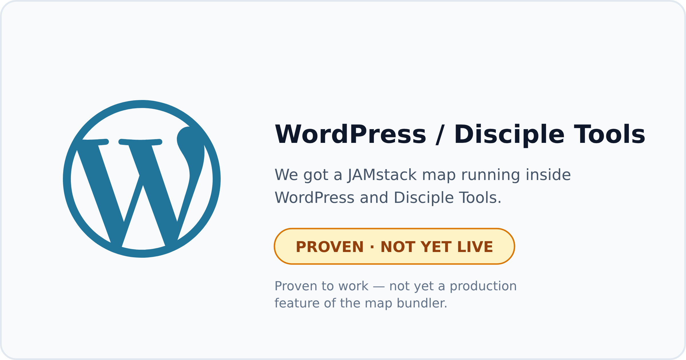

<details>
<summary><b>More about WordPress / Disciple Tools</b></summary>

It works, but it isn't yet a production feature of the map bundler. Two ways to try it:

- **Easiest:** paste the iframe or JavaScript snippet into a WordPress **Custom HTML** block.
- **As a plugin:** install `deployment/wordpress/doxa-maps-embed/` in `wp-content/plugins/`. It adds
  a `[doxa_map]` shortcode and a block for the block editor.

`bun run check:wp-embed` confirms the plugin writes the right HTML, without needing WordPress
installed.

</details>

### Output 2 — the mobile app ✅ built

**The same maps, wrapped as a phone app.** No new code — the maps are JAMstack: they fetch their data
from a remote API, which is exactly what a mobile app needs.

<p align="center"></p>

<details>
<summary><b>More about the mobile app</b></summary>

[Capacitor](https://capacitorjs.com) wraps the built folder into an Android app. Shown here: the
UPG-100 prayer lists and posters at phone size, each poster with its own print options.

```bash
bun run check:mobile   # checks the app is wired up correctly — needs no Android tools
bun run phone          # builds the app and installs it on a phone or emulator
```

`bun run phone` needs the Android SDK, JDK 17 and `adb`. Only Android is set up; iOS is not yet.

</details>

### Output 3 — the desktop app 🧪 proven, not yet in production

**We got the JAMstack map app running as a desktop app.**

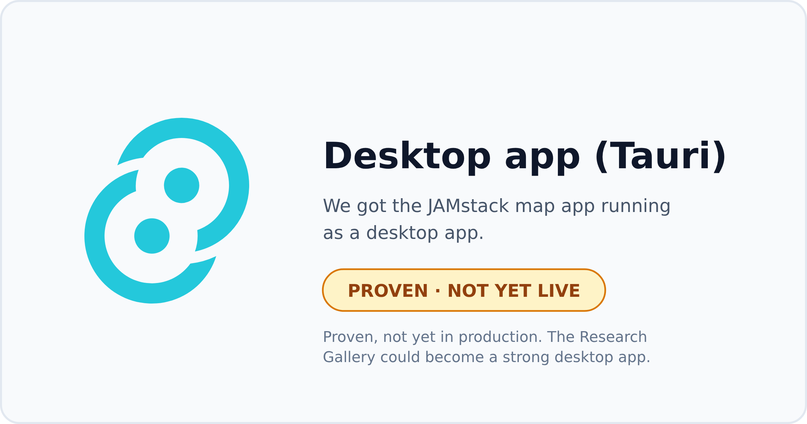

<details>
<summary><b>More about the desktop app</b></summary>

[Tauri](https://tauri.app) wraps the same built folder into a desktop program: it produced a Linux
app and a `.deb` installer. It isn't in the dx bundler for production yet — and the Research Gallery
could become a strong desktop app.

```bash
bun run check:tauri    # checks the desktop setup — needs no Rust tools
bun run tauri:build    # builds the app — needs Rust, the Tauri CLI and webview libraries
```

</details>

<sub>WordPress and Tauri marks from [Simple Icons](https://simpleicons.org) (CC0); the trademarks belong to their owners.</sub>

---

## Security controls

**Bundle integrity.** Every bundle ships with a SHA-384 hash in `public/dx-maps/manifest.json`
(`bundles[].integrity`), and every copy-paste script snippet (`profiles[].embed.script`) already
uses it:

```html
<script src="https://YOUR_HOST/dx-maps/doxa-simple-map/doxa-simple-map.js"
        integrity="sha384-…" crossorigin="anonymous"></script>
```

If the file on the host is changed by anyone, even by one byte, the browser refuses to run it.
`crossorigin="anonymous"` is required for the check to work across sites, so the host must send
`Access-Control-Allow-Origin: *`. Copy the snippet again after each release, because the hash changes
with the bundle. `bun run check:sri` keeps the manifest and the built pages in step.

<details>
<summary><b>The backend in the cloud container (v1, experimental)</b></summary>

- **Locked by default.** A new PocketBase collection starts with admin-only rules; you open it
  deliberately, collection by collection.
- **Dashboards hidden.** The production instance exposes only its `/api/`; its admin dashboard is
  blocked at the proxy. The development dashboard is open only to the admin group.
- **No server-side code.** PocketBase's JavaScript hooks are switched off in both instances.
- **Not built yet:** per-plugin locks between plugin authors (who may edit which plugin's backend)
  and isolated edge functions. Until they exist, everyone with dev access is trusted with every
  plugin's backend.

</details>

---

## Languages

**Every map speaks 11 languages** — add `?lang=<code>` to a map's page address, or, when a map is embedded in
your own page, set `"locale"` in its `profile-config`. Arabic reads right to left.

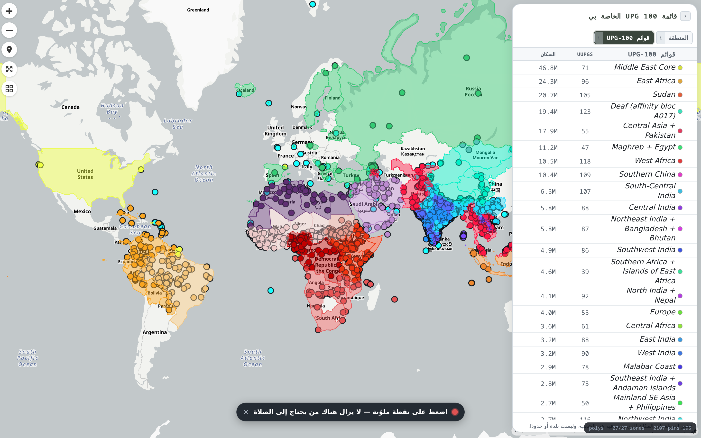

<sub>UPG-100 List with `?lang=ar`: the interface is in Arabic; people-group and place names come from the data.</sub>

| Code | Language | | Code | Language |
|---|---|---|---|---|
| `en` | English | | `hi` | हिन्दी — Hindi |
| `ar` | العربية — Arabic (right to left) | | `it` | Italiano — Italian |
| `de` | Deutsch — German | | `pt` | Português — Portuguese |
| `es` | Español — Spanish | | `ro` | Română — Romanian |
| `fr` | Français — French | | `ru` | Русский — Russian |
| `zh` | 中文 — Chinese | | | |

<details>
<summary><b>More about languages</b></summary>

- **Pick a language with the address:** `…/prayer/index.html?lang=fr` shows the map in French. It
  works on every map's own page and on the Research Gallery. `?locale=` works too.
- **Set it from your own page:** when you embed the Research Gallery or a single map with the
  JavaScript embed, put the language in its `profile-config` (`"lang"` works too). Set it again
  later and the map switches language live.

  ```html
  <doxa-maps-spa profile-config='{"locale":"ar"}'></doxa-maps-spa>
  ```
- **Without either,** a map follows the page's own language (`<html lang>`, which WordPress sets), and
  otherwise shows English.
- **Right to left:** in Arabic the map's layout mirrors — the Research Gallery's tab rail moves to
  the right. Set through `profile-config`, only the map's own box mirrors; the rest of your page is
  left alone. A `?lang=ar` address mirrors the whole page, which is what a map's own page wants.
- **Where the words live:** `library/i18n/locales/<code>/`, one folder per language. Adding a
  language: [documentation/architecture/i18n.md](./documentation/architecture/i18n.md).

</details>

---

## Build it with an agent swarm

**Many AI agents can build many plugins at once without breaking each other's work.** Every plugin
has one agent building it, and one shepherd agent makes sure every agent does its job well. All the
plugins live in one project with one shared library, and changes are added to `main` — the one
official version — one at a time.

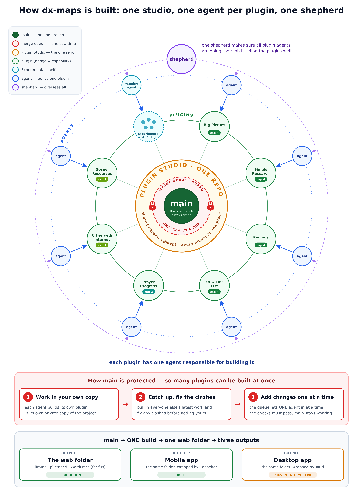

<details>
<summary><b>What problem does this solve? (in plain words)</b></summary>

All the maps here share **one project, one library and one build step**. That's what makes them
work together, and it's also the danger: if one agent's change breaks the shared library, **every
map breaks at once**. And when several agents work in the same project at the same time, they step on
each other — two agents edit the same file, one change quietly erases another, or half-finished work
lands in the version everyone else is using.

So the project works like a busy kitchen with one head chef:

1. **Each agent works in its own copy of the project** — its own counter, so nobody bumps anybody.
2. **Before adding its work, each agent catches up**: it pulls in everyone else's latest work and
   fixes any clashes with its own. The agent fixes the clash, not the next person.
3. **Only one agent adds work at a time.** They wait in a line (the *merge queue*), the checks run,
   and only then does the change go into `main`. `main` always works.
4. **A shepherd agent watches everyone**: plugins built in the studio, shared parts really shared,
   and every change going through the line.

That's how many plugins get built at the same time, in one project, without the maps breaking.

</details>

<details>
<summary><b>The words, if you're new to git</b></summary>

| Word | In plain terms |
|---|---|
| **repo** | the project folder, with its full history |
| **main** | the one official version of the project that everyone builds from |
| **worktree** | a private copy of the project for one agent to work in |
| **merge conflict** | two changes touched the same lines; someone has to decide how to combine them |
| **rebase** | catching your work up with everyone else's latest before adding it |
| **merge queue** | the line agents wait in, so only one change goes into `main` at a time |

</details>

<details>
<summary><b>The commands (for the curious)</b></summary>

```bash
# one private copy (worktree) + one agent per plugin
git worktree add -b regions/work ../dx-maps-regions main
git worktree add -b upg100/work  ../dx-maps-upg100  main

# one preview server per agent, each on its own port
bun x vite --port 5301 --strictPort

# add work through the line: one at a time, caught up first, checks must pass
flock /tmp/dx-maps-main.lock sh -c '
  git fetch origin && git rebase origin/main &&
  bun run gates:pre && git push origin HEAD:main'
```

One agent owns the full build (it rebuilds everyone's output); the others check just their own
plugin with `BUNDLE=<name> bun x vite build`. How to contribute, and the bar for shared code:
[documentation/CONTRIBUTING.md](./documentation/CONTRIBUTING.md). Diagram source:
[`delegation-model.svg`](./documentation/readme-images/src/delegation-model.svg).

</details>

---

## The Plugin Studio — ★ where you work

**Every plugin in one place, sorted by capability.** Pick any plugin to run it live, fold open the
plugins inside it, and copy its embed code. Tell your agent which plugins to **group**, and it builds
a higher-capability plugin from them — that's how the Research Gallery was built.


### Get it running

You need **git**, **[Bun](https://bun.sh)** and **Node ≥ 18**, plus a free
**[Mapbox](https://account.mapbox.com) public token** (it starts with `pk.`) so the maps have a
background. For Rudder's voice engine, also **[Go](https://go.dev/dl/) 1.22+**, then run
`bash backend/rudder-engine/setup-runtime.sh` once; without Go, everything except voice works.

```bash
git clone --depth 1 https://git.nuxtbase.app/doxa-open/doxa-maps.git   # latest code only: seconds, not hundreds of MB of history
cd doxa-maps
bun install --frozen-lockfile
cp .env.example .env            # optional: paste your pk. token after VITE_MAPBOX_TOKEN=
bun run dev                     # → http://localhost:5173/  is the Plugin Studio
```

No build needed first — the built maps are already in the repo. To start a plugin, copy
`plugin-designs/template-bundle/` to `plugin-designs/<your-map>/`; the studio finds it automatically.

<details>
<summary><b>Make changes to the studio itself</b></summary>

The studio is a plugin like any other: `plugin-designs/plugin-studio/plugin-studio.vue`.

1. Run `bun run dev` and open http://localhost:5173/ — that page *is* the studio.
2. Edit `plugin-studio.vue` (or ask your agent to). The page updates as you save.
3. When it looks right, build just the studio and refresh its security hashes:

   ```bash
   BUNDLE=plugin-studio bun x vite build
   bun run fix:sri
   ```

4. Check it opens every plugin: `bun run smoke:studio` (with `bun run dev` running).

</details>

<details>
<summary><b>No Mapbox token? And other map settings</b></summary>

- **No token:** set `"provider": "maplibre"` on any plugin (or add `?provider=maplibre` to a map's
  page) and it draws with MapLibre, which needs no key.
- **Built pages** take a token from `?tk=pk.…` in the address, from a token you paste once into the
  page, or from a token endpoint.
- Every command and prerequisite, per deployment method:
  [documentation/README-SECTION-3-cli-commands.md](./documentation/README-SECTION-3-cli-commands.md).

</details>

| Command | What it does |
|---|---|
| `bun run dev` | The Plugin Studio, updating as you save, at http://localhost:5173 |
| `BUNDLE=<name> bun x vite build` | Build one plugin only |
| `BUILD_ALLOW=1 bun run build` | Build everything into `public/dx-maps/` (~4 min; refuses without the flag, to protect a shared project) |
| `bun run serve` | Serve the built output folder — the Plugin Studio is http://localhost:4173/dx-maps/index.html |
| `bun run gates:pre` · `bun run gates:post` | The checks that keep `main` working |
| `bun run shots` | Retake these screenshots (`ONLY=<name>` for one) |

### Run it in the cloud

**One shared dev server for the whole team, no laptop setup.** A container clones the repo, follows
`main`, and hot-reloads every change an agent lands, so everyone sees the Plugin Studio update in
their browser within seconds, with no rebuild. Add OIDC settings and it puts a "Sign in with *your
provider*" page in front of everything, open only to the groups you allow. Recipe and settings:
[deployment/cloud/](./deployment/cloud/README.md).
Working from your own laptop alongside the team (zero config, everything local by default):
[documentation/HOWTO-join-the-table.md](./documentation/HOWTO-join-the-table.md). When your agent runs on a
server instead: [documentation/CLOUD-DEVELOPMENT-ENVIRONMENT.md](./documentation/CLOUD-DEVELOPMENT-ENVIRONMENT.md).
All four ways dx-maps ships (laptop, shared cloud dev server, public embeds, a folder in your own site):
[documentation/DEPLOY.md](./documentation/DEPLOY.md).

---

## Repository layout

```text
doxa-maps/
├── plugin-designs/            YOUR maps — one folder per plugin (the free zone)
│   ├── doxa-maps-spa/         the Research Gallery (capability 5)
│   ├── plugin-studio/         the Plugin Studio (capability 5)
│   ├── my-upg-100-list/       UPG-100 List (capability 4)
│   ├── doxa-simple-map/       Prayer Progress and its presets (capability 2)
│   ├── all-people-groups/     a single map (capability 1)
│   └── template-bundle/       copy this to start a new plugin
│       ├── template-map-a.vue     the map itself
│       ├── index.js               registers its HTML tag
│       ├── index.html             a preview page
│       └── src/                   private pieces only this plugin uses
├── library/                   the SHARED toolkit, imported as @map (the high bar)
│   ├── layouts/               VerticalTabsLayout, StackLayout — how composites compose
│   ├── components/            legends, map controls, search, posters, detail panels
│   ├── composables/           map instance, data, layers, shared helpers
│   ├── colors/ styles/        colour strategies and the house style
│   ├── i18n/locales/          the 11 languages
│   └── data/ api/             lookup tables and data sources
├── public/dx-maps/          the BUILD OUTPUT — the drop-anywhere folder + manifest.json
├── deployment/                mobile (Capacitor) · WordPress · desktop (Tauri)
├── internal/                  the build and its checks
└── documentation/             tutorial · how-to · reference · architecture
```

<details>
<summary><b>Where your code goes — a plugin, or the shared library?</b></summary>

- **Write your app in `plugin-designs/<your-map>/`.** On the build step it becomes its own plugin in
  the output folder — its own embeddable app. Nothing you do there can break anyone else's map.
- **Only put something in `library/` if it is genuinely reusable *and* parameterized** — built so
  other maps can use it with their own settings. The library is shared by every map, so every edit
  there can break every map: it is a high bar. Keep anything specific to one map inside that map's
  own folder.
- The full contribution guide: [documentation/CONTRIBUTING.md](./documentation/CONTRIBUTING.md) ·
  every reusable piece you can import: [documentation/reference-library-index.md](./documentation/reference-library-index.md).

</details>

> **Maps should be open source, run everywhere, and multiply.** One build makes each map a
> self-contained file for your site, your partners' sites and a phone. The Plugin Studio is where
> you compose them into something bigger.

---

## Acknowledgements

dx-maps stands on the work of open-source communities: [Vue](https://vuejs.org), [Vite](https://vite.dev),
[MapLibre GL JS](https://maplibre.org), [Pinia](https://pinia.vuejs.org), [Vue I18n](https://vue-i18n.intlify.dev),
[Capacitor](https://capacitorjs.com), [Tauri](https://tauri.app), [oauth2-proxy](https://github.com/oauth2-proxy/oauth2-proxy),
[NeMo-Speech.cpp](https://github.com/NVIDIA/NeMo-Speech.cpp) with NVIDIA's open [Nemotron speech model](https://huggingface.co/nvidia/nemotron-3.5-asr-streaming-0.6b), and the map data of
[OpenStreetMap](https://www.openstreetmap.org/copyright) contributors served by [OpenFreeMap](https://openfreemap.org). Thank you.
