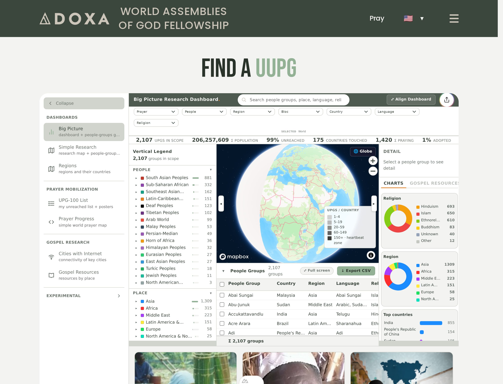

# Embedding the Research Gallery



`<doxa-maps-spa>` (labeled **Research Gallery**) is the capability-5 app shell: one element whose
tab rail nests every production map. It is built to drop onto somebody else's page. Below,
`TREE` means the URL of the built `doxa-maps/` folder wherever it is served, for example
`https://YOUR-HOST/doxa-maps`.

## At a glance

| | **Script embed** | **iframe embed** |
|---|---|---|
| **Paste** | two lines: `<script>` + `<doxa-maps-spa>` | one `<iframe>` |
| **Sizing** | a block in your layout, `85vh` by default | whatever size you give the frame |
| **Language** | follows your page (`<html lang>`), or `language="…"` | `?lang=…` on the `src` |
| **Open on a map** | `tab="upg-100"` | `?tab=upg-100` |
| **Keyless maps** | `provider="maplibre"` | `?provider=maplibre` |
| **Your server must send** | CORS on the whole tree | CORS + `frame-ancestors` on the leaf page |

**Seven production maps** sit in the rail: Big Picture, Simple Research and Regions (Dashboards);
UPG-100 List and Prayer Progress (Prayer Mobilization); Cities with Internet and Gospel Resources
(Gospel Research). An Experimental folder collects everything else in the tree.

## Script embed (recommended)

```html
<script src="TREE/doxa-maps-spa/doxa-maps-spa.js"></script>
<doxa-maps-spa></doxa-maps-spa>
```

That is the whole embed. The element finds its tree from its own `<script>` URL, reads
`TREE/manifest.json`, and takes the data API and public map token from the manifest's
`runtime` block. It sizes itself as a block that is `85vh` tall (minimum 480px) and lays out
inside its own box. To change the height, either:

```html
<doxa-maps-spa style="height: 900px"></doxa-maps-spa>
<!-- or, from your stylesheet -->
<style> doxa-maps-spa { --doxa-maps-spa-height: 70vh; } </style>
```

## iframe embed

```html
<iframe src="TREE/doxa-maps-spa/doxa-maps-spa/index.html"
        style="width:100%; height:85vh; border:0" allow="fullscreen"></iframe>
```

Add `?tab=<id>` to the `src` to open a specific map.

## Attributes (all optional)

| Attribute | Default | What it does |
|---|---|---|
| `tab` | device default (Big Picture on desktop, Simple Research on phones) | Tab id to open first. Changing it later switches tabs. `?tab=` on the page URL works too. |
| `language` | your page's language | UI language for the gallery and every tab. Without it the gallery follows your page: `?lang=` in the URL, then `<html lang>` (watched live, so a page that switches language switches the gallery), then English. The visitor's browser language is never used on its own. 11 languages ship: `ar de en es fr hi it pt ro ru zh`. |
| `api-base-url` | manifest `runtime.apiBaseUrl` | Data API. Only applied when the page has not already set `window.MAP_APP_API_URL`. |
| `provider` | each map's own default (Mapbox) | Map engine for every nested map: `maplibre` needs no token and makes no Mapbox requests; `mapbox`. Forwarded to each map and, when the page has not set `window.MAP_PROVIDER`, set there too so maps nested inside composites follow. In the iframe embed use `?provider=maplibre`. |
| `tk` | manifest `runtime.token` | Mapbox public token. Only fills `window.MAP_TOKEN` when the page has not set one. |
| `token-url` | none | Token endpoint forwarded to each map. |
| `tree-base` | derived from the script URL | Pin the tree root explicitly (needed only when the script is re-hosted apart from its tree). |
| `heading` | `DX-Maps` | Shell title (shown only when the shell header is enabled). |

Tab ids: `dashboard-plus-grid` (Big Picture), `research-map-plus-grid` (Simple Research),
`regions-dashboard`, `upg-100`, `prayer-map` (Prayer Progress), `cities-internet`,
`gospel-resources`, and every Experimental bundle by its bundle name.

## Events

The element dispatches `tab-change` whenever the visible map changes, so the host page can
mirror it into its own URL or analytics:

```js
document.querySelector('doxa-maps-spa')
  .addEventListener('tab-change', (e) => console.log(e.detail[0].id, e.detail[0].label))
```

## A good guest on your page

The gallery is tested to leave its host page as it found it: it does not scroll your page, rewrite
your URL or `<title>`, or inherit your body typography (a blog's `font: 20px/3` stays outside the
box). It does add `@font-face` rules and the map engine's stylesheet to your `<head>`; fonts have to
be declared at document level to reach a shadow root, and the engine styles only target map classes.
Direction follows the gallery's language: in Arabic the whole shell mirrors, with the tab rail on the right. `bun run check:gallery-embed` enforces all of this.

## What the server must send

Both headers are **required** on a host other than the one serving the tree:

- **`Access-Control-Allow-Origin: *` on the whole tree**, including `manifest.json` at its root
  and `assets/`. The gallery and its maps `fetch()` these after mounting, and `fetch()` enforces
  CORS; a `<script>` tag alone does not. If `manifest.json` lacks the header, every tab shows
  "Could not load …".
- **`Content-Security-Policy: frame-ancestors *`** on `doxa-maps-spa/doxa-maps-spa/index.html`,
  for the iframe embed only.

`serving/traefik-embed-headers.yaml` has a ready rule for both.

## Prove it

```sh
bun run check:gallery-embed            # serves the built tree + a foreign host page, drives every tab in both modes
bun run check:gallery-embed:maplibre   # same, keyless: provider=maplibre must make zero api.mapbox.com requests
```
